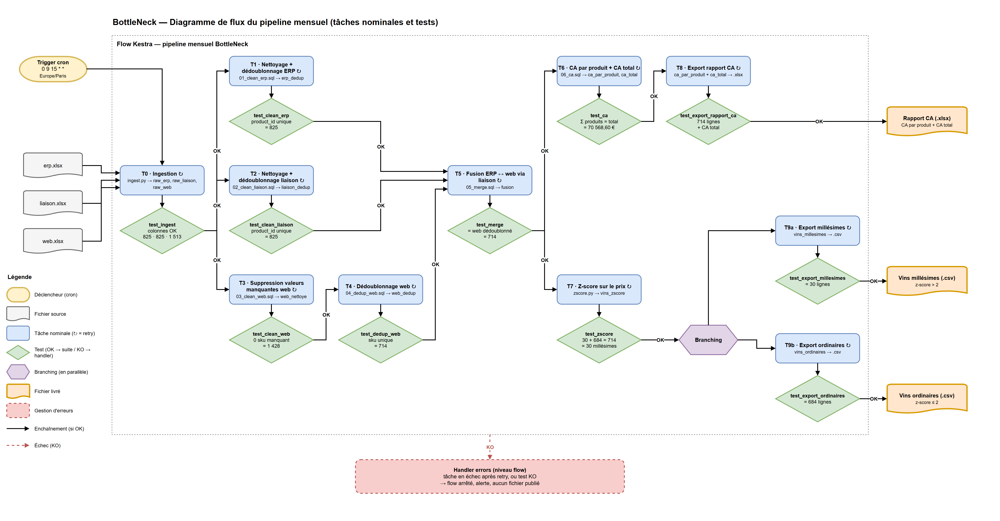

# BottleNeck — Pipeline d'orchestration Kestra

Automatisation avec Kestra du nettoyage, de la réconciliation et de l'analyse
des données ERP et CMS de BottleNeck : rapport mensuel du chiffre d'affaires
et extractions des vins millésimes / ordinaires.



Projet OpenClassrooms, parcours Data Engineer, « Mettez en place un pipeline
d'orchestration des flux ».

## Stack

| Couche             | Outil                                   |
| ------------------ | --------------------------------------- |
| Orchestration      | Kestra v2.0.5 (Docker, standalone + H2) |
| Moteur SQL         | DuckDB (fichier local)                  |
| Traitement / stats | Python 3.11, pandas, openpyxl           |
| Schéma             | Draw.io                                 |
| Sorties            | Excel `.xlsx` + CSV                     |
| Planification      | Trigger Kestra, cron `0 9 15 * *`       |

## Le pipeline

`erp.xlsx` + `web.xlsx` réconciliés via `liaison.xlsx` → nettoyage et
dédoublonnage DuckDB → fusion → CA par produit et CA total → vins millésimes
par z-score > 2 → rapport `.xlsx` et deux `.csv`, le 15 de chaque mois à 9 h.

Chaque tâche est suivie d'une tâche de test qui vérifie son résultat. En cas
d'échec : 3 essais à 1 min d'écart, puis le flow s'arrête et le handler
`errors` signale la tâche en cause.

```text
flows/bottleneck_pipeline.yaml   le flow Kestra
scripts/sql/                     nettoyage, dédoublonnage, fusion, CA (DuckDB)
scripts/python/                  ingestion, z-score, exports
scripts/tests/checks.py          les tâches de test
```

## Lancer le projet

Prérequis : Docker Desktop et Python sur l'hôte.

```bash
cp .env.example .env   # remplir identifiants Kestra + nom/prénom/date
make data              # télécharge les 3 .xlsx dans data/raw/
make up                # construit l'image et démarre Kestra
make check             # rejoue la chaîne dans DuckDB et lance les tests
```

Sous Windows sans `make` : `.\make.ps1 data`, `.\make.ps1 up`, etc.

L'UI Kestra est sur <http://localhost:8080>. On y importe
`flows/bottleneck_pipeline.yaml`, puis on lance une exécution. Les 3 fichiers
sont écrits dans `data/outputs/` et restent téléchargeables dans l'onglet
*Outputs* de chaque exécution.

## Valeurs de référence

| Contrôle                      | Attendu      | Obtenu       |
| ----------------------------- | ------------ | ------------ |
| `erp` après dédoublonnage     | 825          | 825          |
| `liaison` après dédoublonnage | 825          | 825          |
| `web` après nettoyage         | 1 428        | 1 428        |
| `web` après dédoublonnage     | 714          | 714          |
| Fichier fusionné              | 714          | 714          |
| Chiffre d'affaires total      | 70 568,60 €  | 70 568,60 €  |
| Vins millésimes               | 30           | 30           |

## Documentation

- [docs/architecture-flux.md](docs/architecture-flux.md) — enchaînement des tâches et tests
- [docs/workflow-kestra.md](docs/workflow-kestra.md) — le flow tâche par tâche
- [docs/strategie-tests.md](docs/strategie-tests.md) — tests, retry, gestion d'erreurs
- [docs/data-dictionary.md](docs/data-dictionary.md) — schéma des fichiers sources
- [docs/adr/](docs/adr/) — décisions d'architecture
- [docs/diagramme-flux.drawio](docs/diagramme-flux.drawio) — diagramme de flux (Draw.io)
