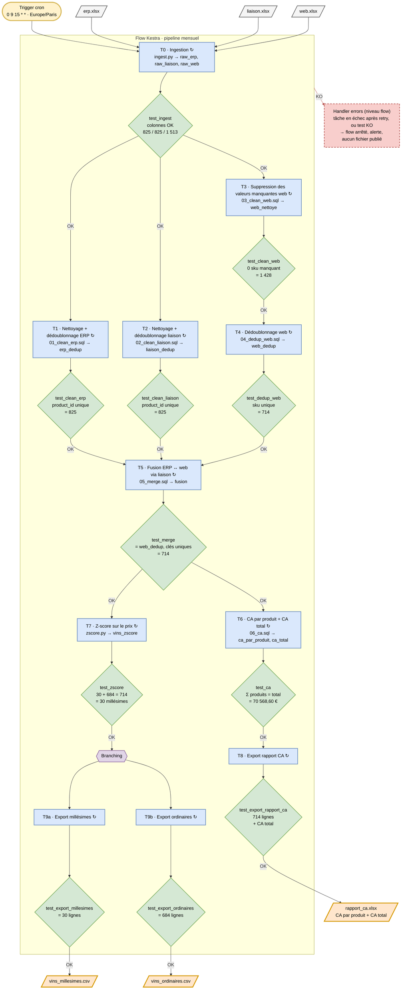

# Architecture du flux — enchaînement des tâches et des tests

> **Étape OC 1 (Data Lineage).** Ce document décrit, à partir des 3 fichiers
> sources, l'enchaînement des tâches qui produisent le rapport CA et les
> extractions des vins, **avec une tâche de test après chaque tâche
> nominale**. Il sert de spécification au diagramme
> [`diagramme-flux.drawio`](diagramme-flux.drawio) et au flow Kestra.
>
> Le diagramme Mermaid en bas de page est le **brouillon validable** de ce
> diagramme : il s'affiche directement sur GitHub et dans VS Code.

## 1. Vue d'ensemble

```text
cron (15 du mois, 9 h)
   │
   ▼
erp.xlsx ┐
liaison  ├─► T0 ingestion ─► ─┬─► T1 ERP ──────────────► ─┐
web.xlsx ┘                      ├─► T2 liaison ──────────► ─┼─► T5 fusion ─► ─┬─► T6 CA ─► ─► T8 export .xlsx ─► 
                                └─► T3 web ─► ─► T4 web ► ─┘                   └─► T7 z-score ─► ─► branching ─┬─► T9a .csv millésimes ─► 
                                                                                                                    └─► T9b .csv ordinaires ─► 
= tâche de test        toute tâche ou test KO ─► handler d'erreurs (flow arrêté, rien n'est publié)
```

Le flow Kestra est **unique** : les tests sont des tâches du même flow, entre
les tâches nominales. Kestra orchestre, les scripts
(`scripts/sql/`, `scripts/python/`) font le travail.

## 2. Tâches nominales → tests → oracles

Les identifiants de tâche (`id`) sont ceux du flow Kestra. Les tables vivent toutes dans `data/warehouse.duckdb`.

| #   | Tâche nominale (`id`) | Script | Entrée → sortie | Test associé (`id`) | Ce que vérifie le test | Famille OC (Étape 3) | Oracle |
| --- | --- | --- | --- | --- | --- | --- | --- |
| T0  | `ingest` | `python/ingest.py` | `erp/liaison/web.xlsx` → `raw_erp`, `raw_liaison`, `raw_web` | `test_ingest` | colonnes attendues présentes, volumétrie brute | *nouvelles sources* (vigilance Étape 2) | 825 / 825 / 1 513 |
| T1  | `clean_erp` | `sql/01_clean_erp.sql` | `raw_erp` → `erp_dedup` | `test_clean_erp` | `product_id` unique, volumétrie | 1 · doublons | **825** |
| T2  | `clean_liaison` | `sql/02_clean_liaison.sql` | `raw_liaison` → `liaison_dedup` | `test_clean_liaison` | `product_id` unique, volumétrie | 1 · doublons | **825** |
| T3  | `clean_web` | `sql/03_clean_web.sql` | `raw_web` → `web_nettoye` | `test_clean_web` | 0 `sku` manquant, volumétrie | 2 · valeurs manquantes | **1 428** |
| T4  | `dedup_web` | `sql/04_dedup_web.sql` | `web_nettoye` → `web_dedup` | `test_dedup_web` | `sku` unique, volumétrie | 1 · doublons | **714** |
| T5  | `merge` | `sql/05_merge.sql` | `erp_dedup` + `liaison_dedup` + `web_dedup` → `fusion` | `test_merge` | lignes = lignes de `web_dedup` (aucun produit web perdu), `product_id` et `sku` uniques (pas de jointure qui duplique) | 3 · cohérence des jointures | **714** |
| T6  | `compute_ca` | `sql/06_ca.sql` | `fusion` → `ca_par_produit`, `ca_total` | `test_ca` | CA total, Σ CA par produit = CA total, aucun CA négatif | 4 · cohérence du CA | **70 568,60 €** |
| T7  | `zscore` | `python/zscore.py` | `fusion` → `vins_zscore` (+ vues `vins_millesimes`, `vins_ordinaires`) | `test_zscore` | nombre de millésimes, millésimes + ordinaires = fusion, tous les millésimes ont z > 2 | 5 · volumétrie z-score | **30** (+ 684 = 714) |
| T8  | `export_rapport_ca` | `python/export_rapport_ca.py` | `ca_par_produit`, `ca_total` → `Nom_Prenom_3_rapport_ca_<mmaaaa>.xlsx` | `test_export_rapport_ca` | fichier présent et relu : onglet CA par produit (714 lignes) + CA total | 4 · cohérence du CA | 714 lignes · 70 568,60 € |
| T9a | `export_millesimes` | `python/export_vins.py` | `vins_millesimes` → `Nom_Prenom_4_vins_millesimes_<mmaaaa>.csv` | `test_export_millesimes` | fichier présent, nombre de lignes | 5 · volumétrie z-score | **30** |
| T9b | `export_ordinaires` | `python/export_vins.py` | `vins_ordinaires` → `Nom_Prenom_5_vins_ordinaires_<mmaaaa>.csv` | `test_export_ordinaires` | fichier présent, nombre de lignes | 5 · volumétrie z-score | **684** |

Les 5 familles de tests demandées (Étape 3 du brief) sont couvertes, et
chacune au plus près de la tâche qui pourrait introduire l'erreur. Les
exports ont aussi leur test : ce sont les fichiers réellement reçus par Laure
et Maria, c'est donc eux qu'il faut vérifier en dernier.

### Deux sortes de contrôles dans chaque test

| Sorte | Exemple | Valable quand ? |
| --- | --- | --- |
| **Invariant** | `sku` unique, 0 valeur manquante, fusion = web dédoublonné, Σ CA produits = CA total, millésimes + ordinaires = fusion | **Toujours**, quel que soit le mois |
| **Oracle** | 825, 1 428, 714, 70 568,60 €, 30 | Pour l'extraction de référence de Stéphane |

Le 15 du mois suivant, les volumes auront changé : les invariants restent
bloquants, les oracles se mettent à jour dans `EXPECTED`
(`scripts/python/settings.py`). C'est un point à présenter en
soutenance : les tests ne vérifient pas seulement « le chiffre de
Stéphane », ils vérifient que **chaque étape fait ce qu'elle doit faire**.

## 3. Dépendances et ordre d'exécution

### Dépendances logiques (ce que montre le diagramme)

- **T0** dépend du trigger et des 3 fichiers.
- **T1**, **T2** et **T3 → T4** sont indépendantes entre elles : chacune ne
  lit que sa propre table brute.
- **T5** attend les 3 branches (`test_clean_erp`, `test_clean_liaison`,
  `test_dedup_web` tous OK) : c'est le point de convergence.
- Après **T5**, la branche **CA** (T6 → T8) et la branche **z-score**
  (T7 → T9a/T9b) sont indépendantes.
- Une tâche ne démarre que si **le test de la tâche précédente est OK**.

### Exécution réelle dans Kestra

| Portion | Exécution | Pourquoi |
| --- | --- | --- |
| T0 → T7 (avec leurs tests) | **séquentielle** | Chaque tâche **écrit** dans `warehouse.duckdb`. DuckDB n'accepte qu'**un seul processus en écriture** sur un fichier : deux tâches en parallèle (`taskRunner: Process`) se bloqueraient. Le gain serait de toute façon nul (chaque étape prend moins d'une seconde). |
| T9a ∥ T9b | **en parallèle** (branching) | Les deux extractions **ne font que lire** la base : plusieurs connexions en lecture seule (`read_only=True`) peuvent coexister. C'est le *branching* recommandé par OC (Étape 2). |

Le diagramme montre donc les **dépendances de données** (le *lineage*), et
le YAML les **sérialise** là où DuckDB l'impose. Les deux sont cohérents :
l'ordre séquentiel retenu (T1, T2, T3, T4, T5…) respecte toutes les
dépendances.

## 4. Placement des éléments transverses

| Élément | Où | Détail |
| --- | --- | --- |
| **Trigger** | entrée du flow | `io.kestra.plugin.core.trigger.Schedule`, cron `0 9 15 * *`, timezone `Europe/Paris`. |
| **Sources** | entrée de T0 | `data/raw/erp.xlsx`, `liaison.xlsx`, `web.xlsx`, lus par pandas (pas de réseau au run, ADR 0001). |
| **Sorties** | après T8, T9a, T9b | `data/outputs/Nom_Prenom_3_rapport_ca_<mmaaaa>.xlsx`, `…_4_vins_millesimes_<mmaaaa>.csv`, `…_5_vins_ordinaires_<mmaaaa>.csv`. Elles ne sont écrites que si **tous** les tests en amont sont OK. |
| **Branching** | après `test_zscore` | Deux branches parallèles : millésimes / ordinaires. |
| **Retry** | sur chaque tâche nominale (T0 → T9b) | 3 tentatives, 1 min d'écart. Couvre les pannes **passagères** : fichier verrouillé, DuckDB indisponible, disque saturé. |
| **Pas de retry sur les tests** | — | Un test KO signale une **donnée** fausse : la relancer donnerait le même résultat. |
| **Handler `errors`** | niveau flow | Se déclenche si une tâche échoue après ses retries, ou si un test est KO. Il journalise la tâche en cause et alerte le Data Engineer. Le flow s'arrête là : **aucun fichier faux n'est envoyé**. |

### Comportement si quelque chose casse

| Situation | Ce qui se passe | Ce que fait l'humain |
| --- | --- | --- |
| DuckDB indisponible, fichier verrouillé (point 6 du mail de Laurent) | La tâche est retentée 3 fois. Si la panne dure, elle passe en échec et le handler alerte. | Corriger la cause, puis **Restart** de l'exécution dans Kestra : elle reprend à la tâche en échec. |
| Un test est KO (donnée inattendue) | Le flow s'arrête net, les sorties ne sont pas produites. Les tables intermédiaires restent dans `warehouse.duckdb`. | Ouvrir la base (`make duckdb`), inspecter la table du test KO, corriger la source ou le script. |
| Nouvelle source, ou colonne renommée dans un export | `test_ingest` échoue (colonnes attendues absentes), avant toute transformation. | Adapter `ingest.py` et le dictionnaire de données. |
| Fichier source absent | `ingest` échoue (fichier introuvable), retry puis handler. | Déposer le fichier dans `data/raw/` et relancer. |

## 5. Diagramme (brouillon Mermaid)

Lecture : rectangles = tâches nominales (↻ = retry), losanges = tests,
parallélogrammes = fichiers, hexagone = branching. Les flèches pleines
s'empruntent si le test est OK. La flèche pointillée rouge mène au handler
d'erreurs.



> Les noms de fichiers de sortie sont abrégés sur le diagramme. Les noms
> complets suivent la convention OC : `Nom_Prenom_<n°>_<nom>_<mmaaaa>`.

## 6. Conventions visuelles (Draw.io)

Chaque catégorie se distingue par **sa forme ET sa bordure**, pas seulement
par sa couleur : le diagramme reste lisible en projection, imprimé en noir et
blanc, ou par une personne daltonienne.

| Élément | Forme Draw.io (bibliothèque *Flowchart*) | Remplissage / bordure | Bordure |
| --- | --- | --- | --- |
| Trigger cron | **Terminator** (rectangle très arrondi) | `#FFF2CC` / `#D6B656` | pleine, 3 pt |
| Fichier source | **Document** | `#F5F5F5` / `#666666` | pleine, 2 pt |
| Tâche nominale | **Process** (rectangle arrondi) | `#DAE8FC` / `#6C8EBF` | pleine, 2 pt |
| Test | **Decision** (losange) | `#D5E8D4` / `#82B366` | pleine, 2 pt |
| Branching | **Hexagon** (*Preparation*) | `#E1D5E7` / `#9673A6` | pleine, 2 pt |
| Fichier de sortie | **Document** | `#FFE6CC` / `#D79B00` | pleine, **3 pt** |
| Handler d'erreurs | **Process** | `#F8CECC` / `#B85450` | **pointillée**, 2 pt |
| Flow Kestra (cadre) | **Container** sans remplissage | — / `#666666` | pointillée, 1 pt |

Les couleurs sont celles de la palette par défaut de Draw.io : un clic suffit
pour les appliquer. Flèches : pleines noires = enchaînement (libellé `OK` en
sortie de test), pointillée rouge = `KO` vers le handler. Police : 14 pt pour
les tâches et les tests, 11 pt pour la ligne script → table.
